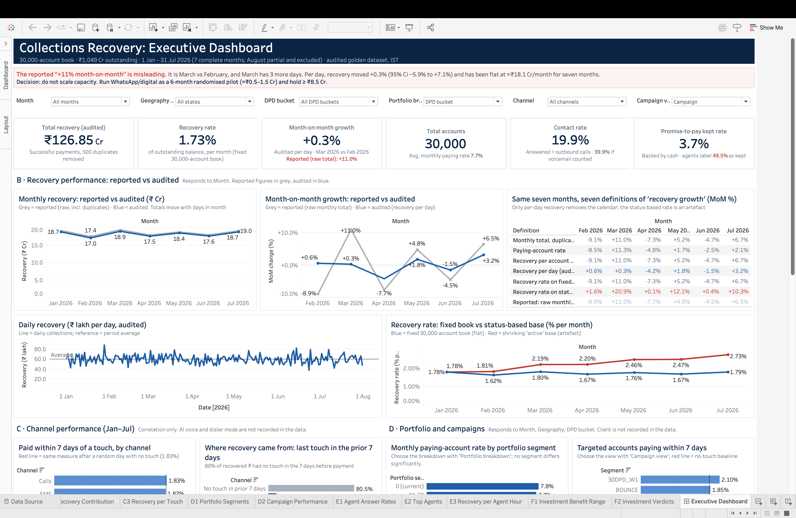

# Collections Recovery Audit: is "+11% MoM" real, and where should ₹10 Cr go?

An end-to-end analysis of 17 messy source systems from a collections platform. It covers forensic cleaning, a reproducible SQL pipeline, statistical tests of the business's claim, a counterfactual, and an evidence-bounded ₹10 Cr investment model.

## Answer in four lines
1. **The +11% is misleading.** It is March vs February, and March has three more days. Per day, recovery moved **+0.3%** (95% CI −5.9% to +7.1%). Over Jan–Jul it is **flat at ≈₹18.1 Cr/month**.
2. **Nothing in the data moves recovery.** Segment, campaign, channel, calling hour, vendor, attempt frequency and agent all show no detectable effect. Payment is not even predictable from history (AUC 0.50).
3. **Several reported KPIs are distorted.** PTP-kept labels (~50%) vs cash (~4%); voicemail counted as contact; 500 payments recorded twice (₹2.59 Cr, 1.9% of cash). A status-based denominator would manufacture a +53% "improvement".
4. **₹10 Cr:** no option is supported by evidence at that scale, and telephony is rejected outright. **Lead option: WhatsApp/digital**, run inside a 6-month randomised test (≈₹0.5–1.5 Cr). **Hold ≥ ₹8.5 Cr.** Enforce 08:00–19:00 IST calling now (54% of calls are outside it).

## Executive dashboard (Tableau)


Open [`Collections_Recovery_Executive_Dashboard.twbx`](Collections_Recovery_Executive_Dashboard.twbx) in Tableau Desktop or Tableau Reader for the interactive version (filters: Month, Geography, DPD bucket, Portfolio breakdown, Channel, Campaign view).

> **Note on `outputs/`:** GitHub's web upload accepts at most 100 files at a time, so the `outputs/` folder (golden parquet, Tableau CSV extracts, validation, forensics and analysis tables, charts) is not in this repository. It is included in the submitted ZIP, and `python run_pipeline.py` regenerates it from the raw CSVs.

## Deliverables
| # | Assignment deliverable | Location | Status |
|---|---|---|---|
| 1 | SQL repository | `sql/` (9 files, run in order by `run_pipeline.py`); explained in `docs/sql_guide.md` | Done |
| 2 | Analysis notebook | `notebooks/analysis.ipynb` (executed); source `notebooks/build_notebook.py` | Done |
| 3 | Golden dataset + pipeline | `outputs/golden/*.parquet`; `run_pipeline.py` rebuilds everything from the raw CSVs | Done |
| 4 | Data quality report | `docs/data_quality_report.md`; source audit in `docs/01_data_validation.md` and `docs/02_source_table_audit.md` | Done |
| 5 | Executive dashboard (Tableau) | [`Collections_Recovery_Executive_Dashboard.twbx`](Collections_Recovery_Executive_Dashboard.twbx) (packaged workbook, data included; open in Tableau Desktop/Reader) and [`Collections_Recovery_Executive_Dashboard.png`](Collections_Recovery_Executive_Dashboard.png) (screenshot) | Done |
| 6 | Executive memo (2 pages) | `docs/executive_memo.pdf` (`.md` source) | Done |
| 7 | Architecture diagram | `docs/architecture.png` / `.svg`; design in `docs/production_design.md` | Done |
| + | ₹10 Cr decision model | `docs/investment_decision.md` | Done |
| + | Quality control | `docs/validation_report.md`, `tests/test_golden.py`, `outputs/dq_results.csv` | Done |
| + | Audit trail | `docs/00_gap_analysis.md`, `docs/assumptions_register.md`, `docs/PROGRESS_LOG.md` | Done |

## Folder structure
```
run_pipeline.py          builds DuckDB + all exports; exits 1 on a blocking data-quality failure
sql/                     00_raw → 10_staging → 05_validation → 20_clean → 30_golden → 40_metrics → 50_forensics → 60_analysis → 70_dq_checks
notebooks/               analysis.ipynb and its generator
scripts/                 profile_source.py (independent table audit), validate_final.py (final QC report)
tests/                   test_golden.py: 9 checks recomputed from the raw CSVs with pandas
outputs/golden/          golden dataset (parquet)
outputs/tableau/         Tableau-ready extracts (CSV)
outputs/validation/      source-data validation results
outputs/forensics/       forensic tests (Part 2)
outputs/analysis/        driver analysis tables
outputs/charts/          figures used in the notebook
docs/                    reports, memo, architecture, registers
data/raw/                place the 17 source CSVs here (not committed)
```

## Technologies
Python 3.11+, DuckDB (SQL engine), pandas, NumPy, SciPy, statsmodels, matplotlib, Jupyter, pytest. No ML beyond one logistic regression, which is used only to test whether payment is predictable.

## Install and run
```bash
python -m venv .venv && source .venv/bin/activate
pip install -r requirements.txt
# unzip collections_30k_dataset.zip into data/raw/  (17 CSVs + data_dictionary.csv)

python run_pipeline.py                 # ~10 s: builds everything, runs 18 data-quality assertions
python scripts/profile_source.py       # independent per-table audit -> docs/02_source_table_audit.md
pytest -q                              # 9 tests recomputed from the raw CSVs
cd notebooks && python build_notebook.py \
  && jupyter nbconvert --to notebook --execute analysis.ipynb --output analysis.ipynb && cd ..
python docs/build_memo_pdf.py          # memo PDF (needs Chrome; optional)
python scripts/validate_final.py       # writes docs/validation_report.md
```
This exact sequence was run in a fresh virtual environment; the result is recorded in `docs/validation_report.md`.

## Datasets (source)
17 tables: borrowers, accounts, agents, agent_sessions, campaigns, daily_targeting, calls, call_attempts, call_dispositions, whatsapp_events, sms_events, field_visits, promises_to_pay, payments, vendor_telephony, complaints, account_status_history.

**Verified coverage:** 1 Jan – 8 Aug 2026, which is 7 complete months. The brief's "≈12 months" is not in the data. Grain, keys and relationships: `docs/01_data_validation.md`.

## Metric definitions (summary; full list in `docs/metric_definitions.md`)
| Metric | Definition |
|---|---|
| Recovery | SUCCESS cash, deduped on `payment_id`, IST; compared **per day** |
| Recovery rate | recovery ÷ outstanding of the **fixed** 30,000-account book |
| Contact rate | answered ÷ outbound calls (voicemail excluded) |
| PTP kept | due PTPs with ≥50% of promised ₹ paid by promised date + 3 days; one payment counts toward one PTP |
| Channel effect | ₹ per account-month regressed on touches (month / DPD / product fixed effects, clustered SE), plus P(pay ≤7 days after touch) vs after a random day |
| Cost per ₹ recovered | not measurable (no cost data); replaced by break-even cost per touch |

## Key findings (with evidence labels)
| Finding | Label |
|---|---|
| Reported 11% = Mar vs Feb SUCCESS sum with duplicates; 10.7 pp is calendar. Verdict: **misleading** | Strong evidence (formula not disclosed) |
| Recovery flat; trend −0.36%/month (HAC 95% CI −1.1% to +0.3%) | Strong evidence |
| 500 payments recorded twice (486 identical, 14 with a dropped reference, 0 ambiguous) = ₹2.59 Cr (1.9%), spread evenly | Fact |
| PTP-kept labels ~50%; cash-verified ~4% | Fact |
| No channel, campaign, segment, hour, vendor or agent effect; no heterogeneity; no predictability | Strong evidence |
| Targeting change: no detectable effect (DiD, robustness, IPW); not causally identified | Correlation |
| Telephony fails even at the 95% upper bound; WhatsApp is the only option whose point estimate beats cost across the cost range | Strong evidence + assumption (unit costs) |
| 54% of calls outside 08:00–19:00 IST | Fact |

## Assumptions
All 31 assumptions are listed with their sensitivity in `docs/assumptions_register.md`. The four that matter most:
- Two rows with the same `payment_id`, account, amount, timestamp and status are one payment (verified for all 500 groups).
- Payment timestamps are IST (no timezone supplied; < 0.7% monthly sensitivity).
- Only SUCCESS is cash (including PENDING does not change the conclusion).
- Unit costs in the investment model are external estimates, not company data.

## Limitations
- 7 months only.
- No cost, client, language or dialer-mode data.
- `call_id` links are broken, so there is no call-level funnel.
- Agent identities can't be resolved.
- Payment timestamps have no timezone (assumed IST; < 0.7% sensitivity).
- No ingestion timestamp on payments, so late arrivals can't be detected.
- `outstanding_amount` has no as-of date; 1,859 payers exceed it, so the *level* of the recovery rate is uncertain (its trend is not).

Details: `docs/data_quality_report.md` §5.
